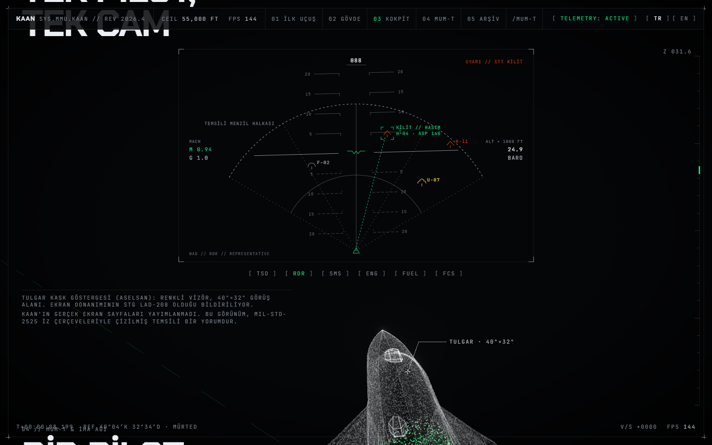
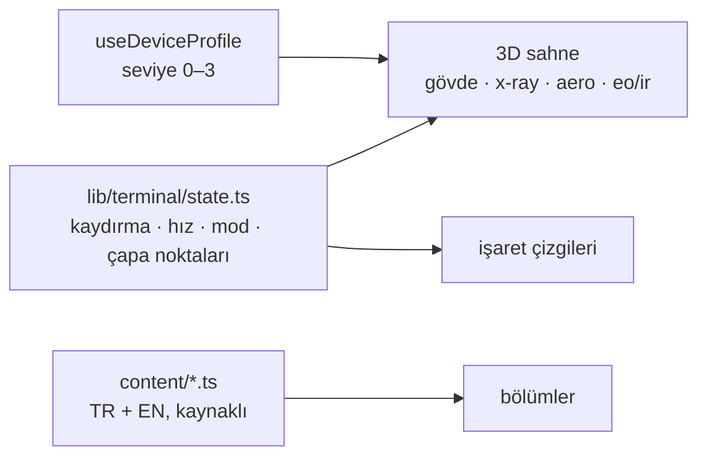

<p align="center">
  
</p>

# KAAN

**[kaan-3d-web-experience.vercel.app](https://kaan-3d-web-experience.vercel.app)** · [English below](#english)

Türkiye'nin beşinci nesil muharip uçağı KAAN için bağımsız bir **havacılık mühendisliği monografisi**. Sayfanın kendisi 3D sahnedir: KAAN, bir hangarın ışığında RAM kaplamalı fiziksel bir nesne olarak duruyor ve her bölümün anıtsal başlığı uçağın arkasından geçiyor. Burundan kuyruğa ilerleyen tek bir tarama düzlemi uçağı dört inceleme modu arasında çeviriyor: **GÖVDE**, **X-RAY** (iç yerleşim), **AERO** (girdap izleri, şok elmasları) ve **EO/IR** (beyaz-sıcak termal görüntü).

> TUSAŞ ile resmi bir bağı yoktur ve kâr amacı gütmez. Kaynak kodu MIT lisanslıdır. Görsellerin, videoların ve modellerin hakları sahiplerine aittir; listesi [/kaynaklar](https://kaan-3d-web-experience.vercel.app/kaynaklar) sayfasında.

| | |
|---|---|
|  |  |
|  |  |

## Bölümler

1. **01 İlk uçuş:** Hangar ışığında KAAN ve arkasında anıtsal başlık. 21 Şubat 2024, 08.50, Mürted uçuş kaydının dört satırı; tüm kayıt ve FLIR beyaz-sıcak filtreli gerçek P0 görüntüsü isteğe bağlı.
2. **02 Gövde:** Kamera gövde altına iner ve sahne X-RAY moduna geçer: S-kanal hava alıkları, iç silah yuvası (temsili yükler), motor fanları.
3. **03 Kokpit:** Kanopi içinden birinci şahıs bakış. Geniş alan ekranı / BVR görünümü, fareyle oynayan yunuslama merdiveni ve MIL-STD-2525 izleri. Hepsi temsili; KAAN'ın gerçek ekran sayfaları yayımlanmadı.
4. **04 MUM-T:** Tepeden bakışta KAAN ve iki ANKA-3, aralarında veri bağı darbeleri. KIZILELMA, KAAN ile entegrasyonu açıklanmadığı için konsept düğüm olarak gösteriliyor.
5. **05 Mühendislik dosyası:** Numaralı levhalar: vizör, tek cetvelli KAAN / F-35A / Su-57 karşılaştırması, sensör ve silah listesi, program takvimi, arşiv şeridi ve uçuş videosu.

Sağdaki inceleme panelinden ya da **1–4** tuşlarıyla mod değiştirilir; **I** serbest yörünge incelemesini açar, **Esc** kapatır. `[ SES ]` tamamen Web Audio ile sentezlenen hangar ve türbin sesini açar (varsayılan kapalı, ses dosyası yok). `[ HUD ]` işaret çizgilerini ve çerçeveyi gizler.

## Çalıştırmak

```bash
git clone https://github.com/SpaceEngineerSS/kaan-3d-web-experience.git
cd kaan-3d-web-experience
npm install
npm run dev          # http://localhost:3000
```

Node 20.9 veya üstü gerekiyor. Yayın öncesi kontrol: `npm run typecheck && npm run lint && npm run build`.

## Nasıl kuruldu

Next.js 16, React 19, Tailwind CSS 4, React Three Fiber 9, drei, özel GLSL shader'lar (mod tarama düzlemi, termal gölgeleme, kanopi ince film), görüntü dosyası olmadan kodla pişirilen hangar ışığı, Web Audio, simplex-noise, motion ve Lenis kullanılıyor. Yazı tipleri Chakra Petch, JetBrains Mono ve Inter.



Ayrıntılar:
- [Mimari](docs/architecture.md)
- [Performans](docs/performance.md)
- [İçerik ve kaynaklar](docs/content-and-sources.md)
- [Görsel hakları](docs/CREDITS.md)
- [Değişiklikler](CHANGELOG.md)

---

<a id="english"></a>

## English

An independent **aviation-engineering monograph** for Türkiye's fifth-generation fighter, KAAN. The 3D scene is the page. KAAN stands as a physical, RAM-coated object under hangar light, with each section's monumental title passing behind it. One sweep plane, travelling nose to tail, turns the aircraft between four inspection modes: **AIRFRAME**, **X-RAY** (internal layout), **AERO** (vortex trails, shock diamonds) and **EO/IR** (white-hot thermal).

The page has five sections:
- **01:** The first flight: the aircraft in the hangar, a four-line flight log, and the real P0 footage behind a FLIR white-hot filter on request.
- **02:** The airframe in X-RAY: S-duct intakes, the internal bay and the fans.
- **03:** A first-person cockpit view with a wide-area display and a BVR picture, marked representative.
- **04:** The MUM-T network with two ANKA-3; KIZILELMA appears as a concept.
- **05:** The engineering file as numbered plates: visor, a one-ruler KAAN / F-35A / Su-57 comparison, sensors and weapons, the programme timeline, and the archive.

Keys **1–4** switch modes, **I** opens free orbit, **Esc** leaves it. `[ SOUND ]` turns on a hangar and turbine soundscape synthesised with Web Audio (off by default, no audio files).

**Not affiliated with Turkish Aerospace (TUSAŞ). Non-commercial.** The source code is MIT licensed. Images, videos and models belong to their owners, who are listed on the [sources page](https://kaan-3d-web-experience.vercel.app/kaynaklar) and in [docs/CREDITS.md](docs/CREDITS.md).

```bash
npm install && npm run dev
```

Corrections that come with a source are welcome; see [CONTRIBUTING.md](CONTRIBUTING.md).

Made by [Mehmet Gümüş](https://github.com/SpaceEngineerSS). 3D model of KAAN by [Kaan Azman](https://www.linkedin.com/in/kaan-azman-591776201/).
