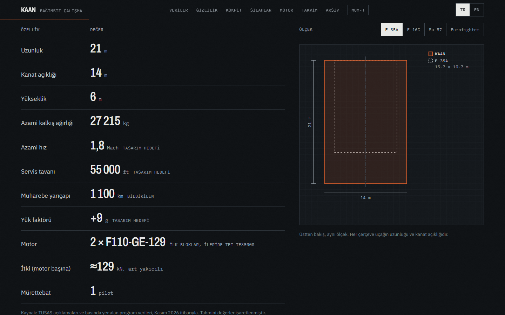
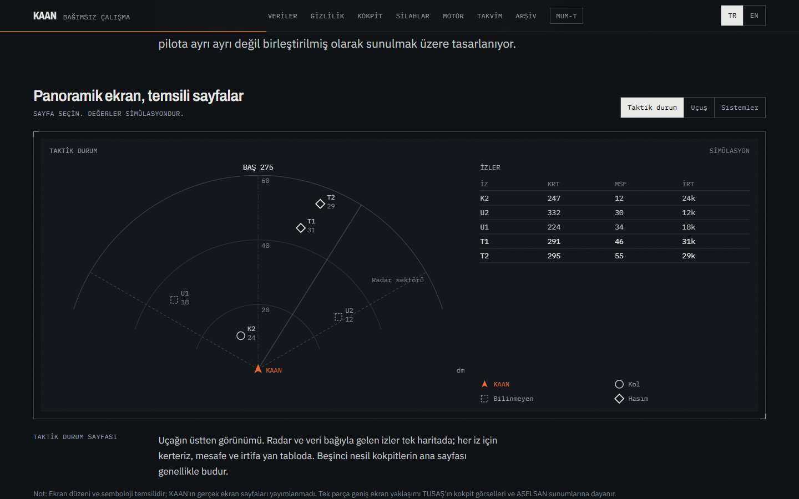
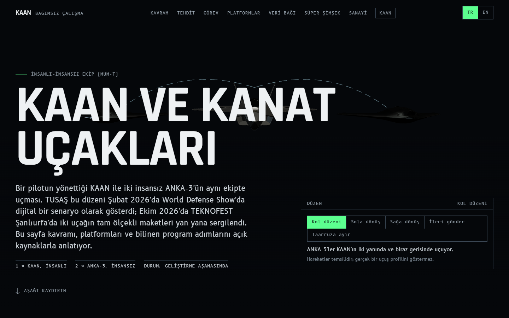
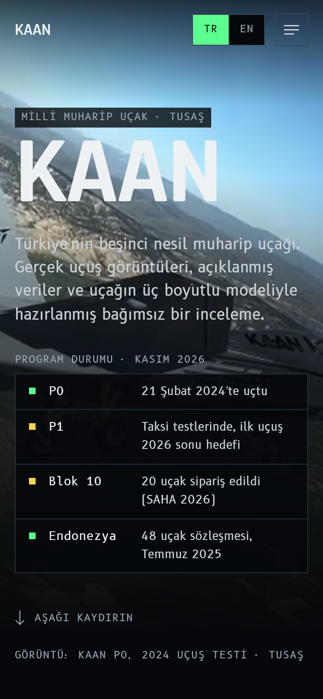
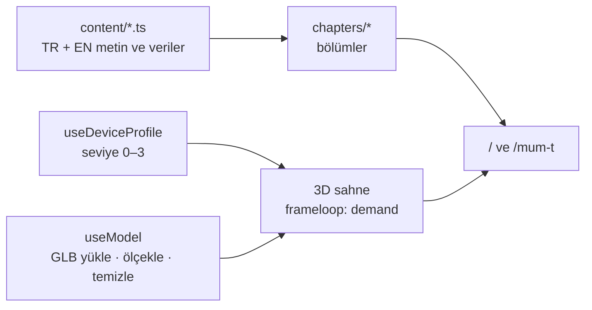

<p align="center">
  
</p>

# KAAN — etkileşimli 3D inceleme

**[kaan-3d-web-experience.vercel.app](https://kaan-3d-web-experience.vercel.app)** · [English below](#english)

Türkiye'nin beşinci nesil muharip uçağı KAAN'ı, açık kaynaklardan derlediğim verilerle ve uçağın 3D modeli üzerinden anlatan bağımsız bir çalışma. Sayfayı kaydırdıkça uçak üstten görünüşten yan profile döner. Ardından teknik veriler, gizlilik tasarımı, kokpit ve aviyonik, silahlar, motor, rakiplerle karşılaştırma, sanayi ortakları ve program takvimi geliyor. İkinci sayfa [/mum-t](https://kaan-3d-web-experience.vercel.app/mum-t), KAAN'ın ANKA-3 insansız savaş uçaklarıyla birlikte uçtuğu insanlı–insansız ekip kavramını işliyor.

> TUSAŞ ile resmi bir bağı yoktur ve kâr amacı gütmez. Kaynak kodu MIT lisanslıdır. Görseller ve modeller sahiplerine aittir; hepsinin kaynağı [/kaynaklar](https://kaan-3d-web-experience.vercel.app/kaynaklar) sayfasında yazıyor.

| | |
|---|---|
|  |  |
|  |  |

### Neler var

- **Kaydırmayla dönen 3D model.** Ön, yan, üst, arka ve kokpit açılarını seçebilir, tel kafes görünümüne geçebilirsiniz.
- **Kaynaklı veriler.** Her rakam ya yayımlanmış bir değer ya da açıkça *tasarım hedefi*, *bildirilen*, *planlanan* veya *tahmini* olarak işaretli. Hesaplanamayan, kaynağı bulunamayan rakamları sildim.
- **Etkileşimli teknik çizimler.** Gizlilik için kenar hizalama ve temsili yansıma deseni, kokpit ekran sayfaları, aviyonik blok şeması, görev profiline göre silah istasyonları ve turbofan kesiti.
- **Türkçe ve İngilizce.** Dil seçimi sayfalar arasında korunuyor.
- **Her cihazda akıcı.** Cihaz dört seviyeden birine ayrılıyor. Zayıf telefonlar daha hafif malzeme ve daha az ışık alıyor, WebGL olmayan cihazlar sabit görsel görüyor. 3D sahne yalnızca bir şey hareket ettiğinde çiziliyor.

### Çalıştırmak

```bash
git clone https://github.com/SpaceEngineerSS/kaan-3d-web-experience.git
cd kaan-3d-web-experience
npm install
npm run dev          # http://localhost:3000
```

Node 20.9 veya üstü gerekiyor. Yayın öncesi kontrol: `npm run typecheck && npm run lint && npm run build`.

### Nasıl çalışıyor



Next.js 16 (App Router), React 19, Tailwind CSS 4, React Three Fiber 9 ve drei, GSAP, Lenis ve Motion kullanıyor. Ayrıntılar [docs/](docs) klasöründe:

- [Mimari](docs/architecture.md)
- [Performans](docs/performance.md)
- [İçerik ve kaynaklar](docs/content-and-sources.md)
- [Görsel hakları](docs/CREDITS.md)
- [Değişiklikler](CHANGELOG.md)

---

<a id="english"></a>

## English

An independent study of Türkiye's fifth-generation fighter, KAAN, built from public sources around a 3D model of the aircraft. As you scroll, the model turns from plan view to profile. The page then covers the specifications, stealth shaping, cockpit and avionics, weapons, engines, a comparison with other fighters, the industrial team and the programme timeline. A second page, [/mum-t](https://kaan-3d-web-experience.vercel.app/mum-t), covers manned–unmanned teaming with the ANKA-3 unmanned combat aircraft.

**Not affiliated with Turkish Aerospace (TUSAŞ). Non-commercial.** Source code is MIT licensed. Images and models belong to their owners, who are listed on the [sources page](https://kaan-3d-web-experience.vercel.app/kaynaklar) and in [docs/CREDITS.md](docs/CREDITS.md).

Every figure on the site is either published, or labelled as a *design target*, *reported*, *planned* or *estimate*. Programme status is current as of November 2026.

```bash
npm install && npm run dev
```

Contributions, especially corrections with a source, are welcome: see [CONTRIBUTING.md](CONTRIBUTING.md).

Made by [Mehmet Gümüş](https://github.com/SpaceEngineerSS). 3D model of KAAN by [Kaan Azman](https://www.linkedin.com/in/kaan-azman-591776201/).
