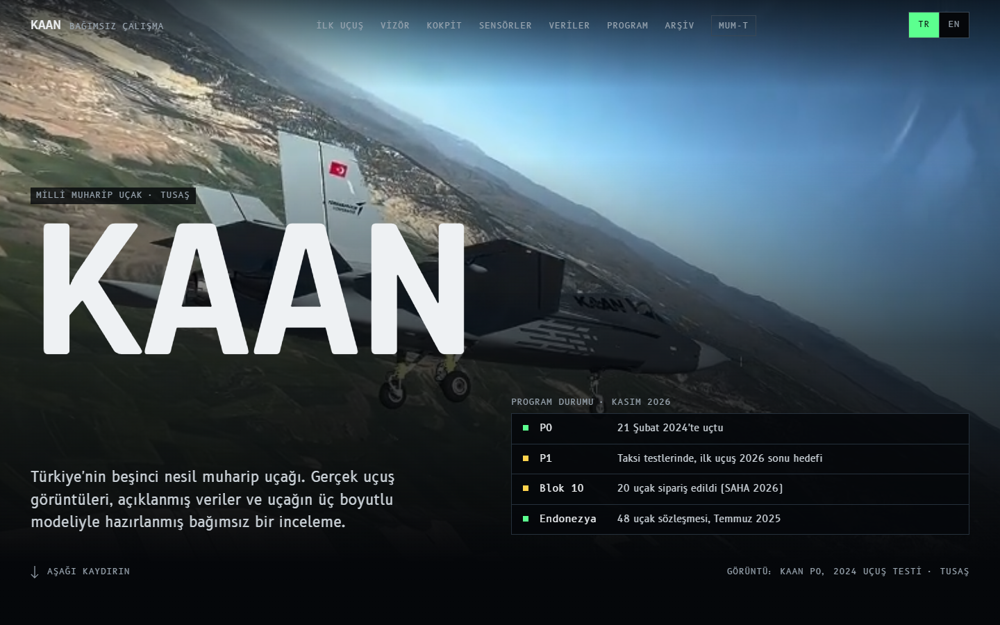
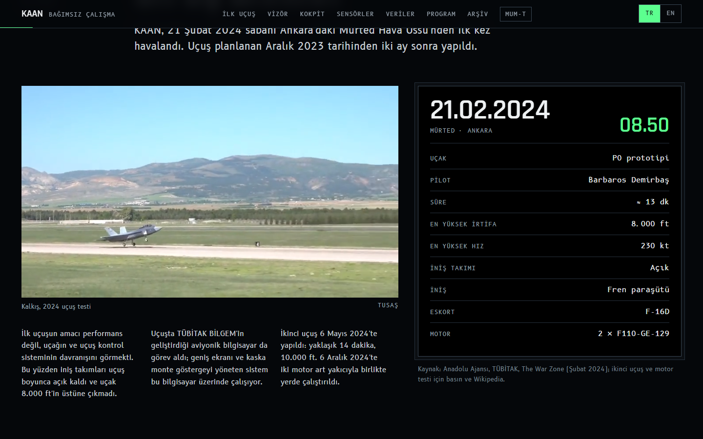
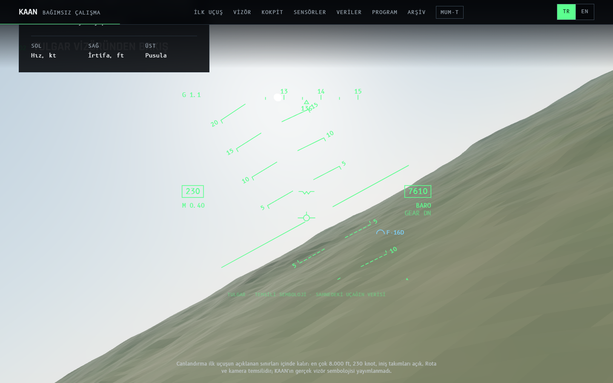
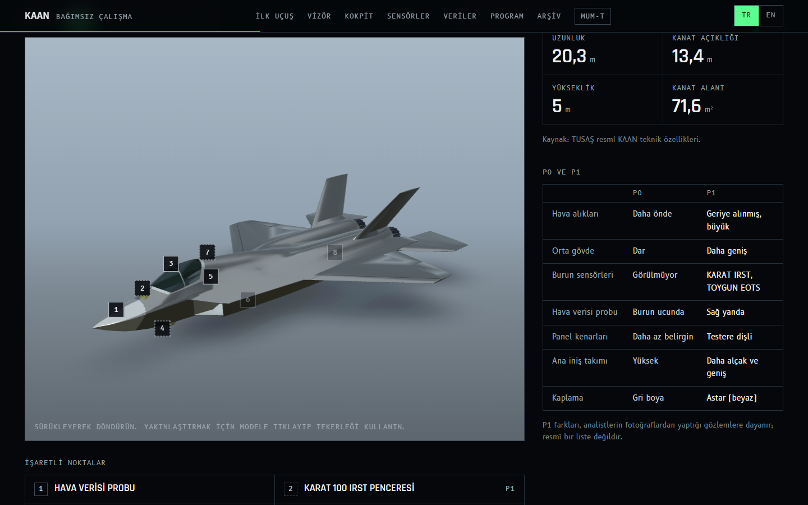
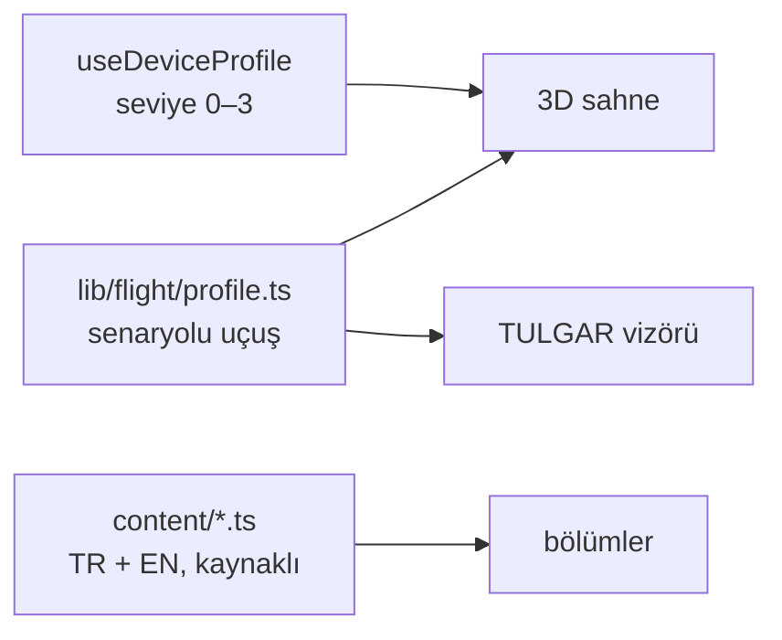

<p align="center">
  
</p>

# KAAN

**[kaan-3d-web-experience.vercel.app](https://kaan-3d-web-experience.vercel.app)** · [English below](#english)

Türkiye'nin beşinci nesil muharip uçağı KAAN'ı uçağın kendi dünyasından anlatan bağımsız bir site. Kullanılan malzemeler:
- TUSAŞ'ın 2024 uçuş testi görüntüleri
- resmi rakamlar
- ASELSAN'ın açıkladığı sistemler
- uçağın 3D modeli

Site bilim kurgu süsü kullanmıyor ve başka uçakları vekil olarak göstermiyor. Her rakamın kaynağı var ya da hedef, bildirilen veya tahmini olduğu açıkça yazıyor.

> TUSAŞ ile resmi bir bağı yoktur ve kâr amacı gütmez. Kaynak kodu MIT lisanslıdır. Görsellerin, videoların ve modellerin hakları sahiplerine aittir; listesi [/kaynaklar](https://kaan-3d-web-experience.vercel.app/kaynaklar) sayfasında.

| | |
|---|---|
|  |  |
|  |  |

## Sayfada neler var

1. **Açılış.** KAAN P0'ın 2024 uçuş testinden kesilmiş sessiz bir döngü. Yanında Kasım 2026 itibarıyla program durumu: P0, P1, Blok 10 siparişi ve Endonezya.
2. **İlk uçuş.** 21 Şubat 2024, saat 08.50, Mürted. Pilot, süre, 8.000 ft, 230 knot, açık iniş takımları, fren paraşütü ve eskort F-16D bir uçuş test kartında; yanında gerçek kalkış görüntüsü.
3. **TULGAR vizöründen bakış.** Kaydırdıkça uçak tırmanır, bulutları geçer ve yatışa girer. Vizördeki semboller, sahnedeki uçağın o anki hızından, irtifasından ve duruşundan çizilir. Canlandırma ilk uçuşun açıklanan sınırlarının içinde kalır.
4. **Gövde.** Döndürülebilen 3D model. Sekiz numaralı noktayla KARAT 100, TOYGUN 100, alıklar, silah yuvaları ve T18T koltuk gösteriliyor; P0'dan P1'e değişenler ayrıca listeleniyor.
5. **Kokpit.**
   - Geniş alan ekranı: iki portal ve alt pencere şeridi; TSD, radar, mühimmat, motor, yakıt ve uçuş kontrol sayfaları.
   - ASELSAN yedek uçuş göstergesi.
   - Ölçekli TULGAR vizör çerçevesi.
   - Hepsi temsili olarak işaretli; KAAN'ın gerçek ekran sayfaları yayımlanmadı.
6. **Sensörler, veriler, silahlar, motor, program ve arşiv.** Hepsi kaynaklı.

İkinci sayfa [/mum-t](https://kaan-3d-web-experience.vercel.app/mum-t), KAAN'ın ANKA-3 ile insanlı–insansız ekip olarak çalışmasını anlatıyor.

## Çalıştırmak

```bash
git clone https://github.com/SpaceEngineerSS/kaan-3d-web-experience.git
cd kaan-3d-web-experience
npm install
npm run dev          # http://localhost:3000
```

Node 20.9 veya üstü gerekiyor. Yayın öncesi kontrol: `npm run typecheck && npm run lint && npm run build`.

## Nasıl kuruldu

Next.js 16, React 19, Tailwind CSS 4, React Three Fiber 9 ve drei, GSAP ve Lenis kullanılıyor. Yazı tipi B612; Airbus'ın kokpit ekranları için yaptırdığı açık kaynak yazı tipi, eksik Türkçe harfleri tamamlanarak siteye gömüldü.



Ayrıntılar:
- [Mimari](docs/architecture.md)
- [Performans](docs/performance.md)
- [İçerik ve kaynaklar](docs/content-and-sources.md)
- [Görsel hakları](docs/CREDITS.md)
- [Değişiklikler](CHANGELOG.md)

---

<a id="english"></a>

## English

An independent site about Türkiye's fifth-generation fighter, KAAN, told through the aircraft's own world. It is built from:
- Turkish Aerospace's 2024 flight-test footage
- the official figures
- the systems ASELSAN has disclosed
- a 3D model of the aircraft

There is no sci-fi decoration and no other aircraft standing in for KAAN.

Highlights:
- **First-flight card.** Details of the flight on 21 February 2024, shown next to real take-off footage.
- **Climb-out through the TULGAR visor.** A scroll-driven 3D sequence whose helmet symbology is computed live from the aircraft in the scene.
- **3D inspection of the airframe.** The model, with the differences between P0 and P1 marked.
- **Large-area cockpit display.** Drawn to documented display conventions and clearly marked as representative.

**Not affiliated with Turkish Aerospace (TUSAŞ). Non-commercial.** The source code is MIT licensed. Images, videos and models belong to their owners, who are listed on the [sources page](https://kaan-3d-web-experience.vercel.app/kaynaklar) and in [docs/CREDITS.md](docs/CREDITS.md).

```bash
npm install && npm run dev
```

Corrections that come with a source are welcome; see [CONTRIBUTING.md](CONTRIBUTING.md).

Made by [Mehmet Gümüş](https://github.com/SpaceEngineerSS). 3D model of KAAN by [Kaan Azman](https://www.linkedin.com/in/kaan-azman-591776201/).
