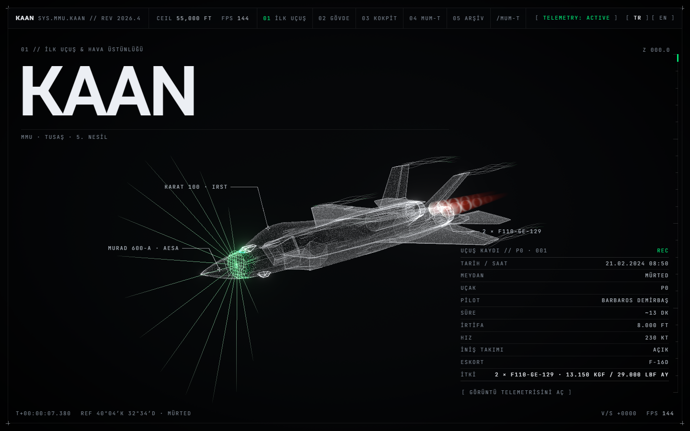
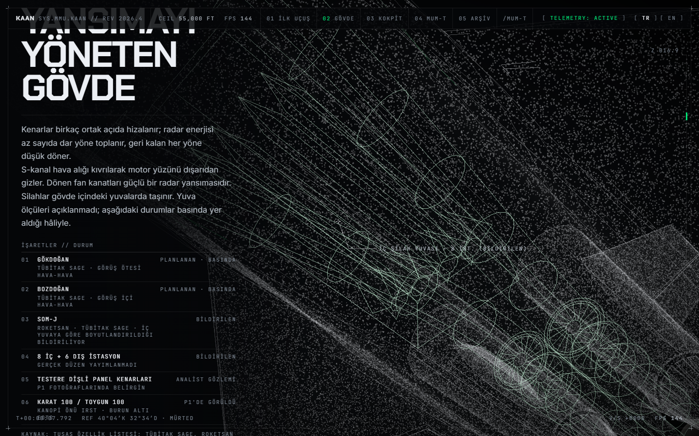
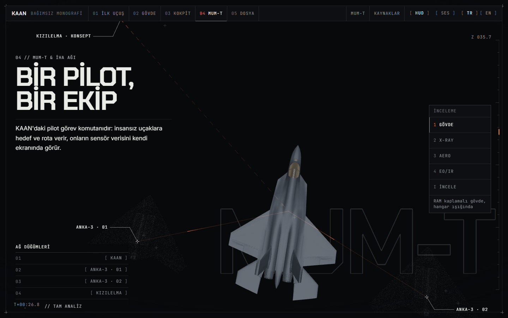
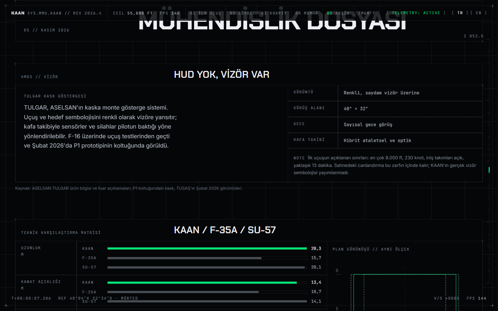
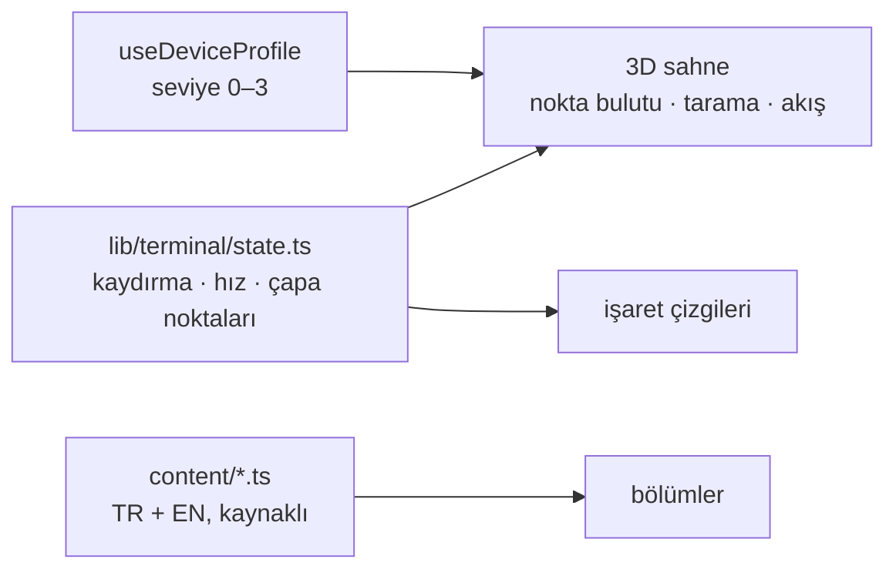

<p align="center">
  
</p>

# KAAN

**[kaan-3d-web-experience.vercel.app](https://kaan-3d-web-experience.vercel.app)** · [English below](#english)

Türkiye'nin beşinci nesil muharip uçağı KAAN için bağımsız bir **uçuş test ve telemetri terminali**. Sayfanın kendisi 3D sahnedir: uçağın modeli lidar nokta bulutu, kesit çizgileri ve X-ışını kabuğu olarak çiziliyor. Gövde boyunca ilerleyen tarama dalgası iç yapıyı ortaya çıkarıyor. Metinler kart değil; 3D noktalara kilitlenen 1 piksellik işaret çizgileriyle uçağa bağlanıyor.

> TUSAŞ ile resmi bir bağı yoktur ve kâr amacı gütmez. Kaynak kodu MIT lisanslıdır. Görsellerin, videoların ve modellerin hakları sahiplerine aittir; listesi [/kaynaklar](https://kaan-3d-web-experience.vercel.app/kaynaklar) sayfasında.

| | |
|---|---|
|  |  |
|  |  |

## Bölümler

1. **01 İlk uçuş:** 21 Şubat 2024, 08.50, Mürted uçuş kaydı. Gerçek P0 görüntüleri FLIR beyaz-sıcak filtresiyle açılır. Egzozda şok elmasları görünür.
2. **02 Gövde:** Kamera gövde altına iner. Tarama dalgası S-kanal hava alıklarını, iç silah yuvasını (temsili yükler) ve motor fanlarını gösterir; bildirilen silahlar ve istasyon sayıları yanında listelenir.
3. **03 Kokpit:** Kanopi içinden birinci şahıs bakış. Geniş alan ekranı / BVR görünümü, fareyle oynayan yunuslama merdiveni ve MIL-STD-2525 izleri yer alır. Hepsi temsili; KAAN'ın gerçek ekran sayfaları yayımlanmadı.
4. **04 MUM-T:** Tepeden bakışta KAAN ve iki ANKA-3, aralarında veri bağı darbeleri. KIZILELMA, KAAN ile entegrasyonu açıklanmadığı için konsept düğüm olarak gösteriliyor.
5. **05 Mühendislik dosyası:** KAAN / F-35A / Su-57 karşılaştırma matrisi, program takvimi, yatay arşiv şeridi ve uçuş videosu.

Ekranın kenarındaki çerçeve canlı görev saatini, ölçülen FPS'i, dikey hızı ve kaydırma derinliğini gösterir. `[ TELEMETRY ]` anahtarı katmanları gizler.

## Çalıştırmak

```bash
git clone https://github.com/SpaceEngineerSS/kaan-3d-web-experience.git
cd kaan-3d-web-experience
npm install
npm run dev          # http://localhost:3000
```

Node 20.9 veya üstü gerekiyor. Yayın öncesi kontrol: `npm run typecheck && npm run lint && npm run build`.

## Nasıl kuruldu

Next.js 16, React 19, Tailwind CSS 4, React Three Fiber 9, drei, özel GLSL shader'lar, simplex-noise, motion ve Lenis kullanılıyor. Yazı tipleri Chakra Petch, JetBrains Mono ve Inter.



Ayrıntılar:
- [Mimari](docs/architecture.md)
- [Performans](docs/performance.md)
- [İçerik ve kaynaklar](docs/content-and-sources.md)
- [Görsel hakları](docs/CREDITS.md)
- [Değişiklikler](CHANGELOG.md)

---

<a id="english"></a>

## English

An independent **flight-test telemetry terminal** for Türkiye's fifth-generation fighter, KAAN. The 3D scene is the page. The model is drawn as a lidar point cloud, blueprint edges and an X-ray shell. A scan band sweeps it to reveal the internals, and 1px leader lines tie the text to points on the aircraft.

The page has five sections:
- **01:** The first flight, with the real P0 footage behind a FLIR white-hot filter.
- **02:** The airframe and internal bays.
- **03:** A first-person cockpit view with a wide-area display and a BVR picture, marked representative.
- **04:** The MUM-T network with two ANKA-3; KIZILELMA appears as a concept.
- **05:** The engineering file: a KAAN / F-35A / Su-57 comparison, the programme timeline, and the archive.

**Not affiliated with Turkish Aerospace (TUSAŞ). Non-commercial.** The source code is MIT licensed. Images, videos and models belong to their owners, who are listed on the [sources page](https://kaan-3d-web-experience.vercel.app/kaynaklar) and in [docs/CREDITS.md](docs/CREDITS.md).

```bash
npm install && npm run dev
```

Corrections that come with a source are welcome; see [CONTRIBUTING.md](CONTRIBUTING.md).

Made by [Mehmet Gümüş](https://github.com/SpaceEngineerSS). 3D model of KAAN by [Kaan Azman](https://www.linkedin.com/in/kaan-azman-591776201/).
