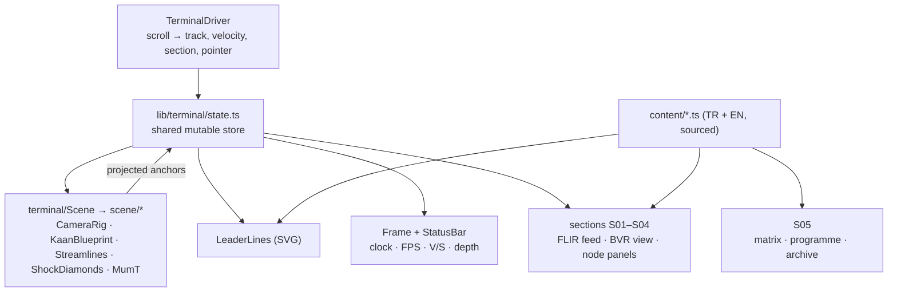

# Architecture

The home page is a flight-test telemetry terminal. One pinned WebGL scene sits behind sections 01–04, and section 05 is a normal editorial page after it.



## Page structure (`src/app/page.tsx`)

```
StatusBar · Frame · TerminalDriver
main
  #track
    sticky 100svh stage: SceneMount (WebGL) + LeaderLines (SVG, md and up)
    S01 · S02 · S03 · S04   (each 150svh, pulled over the stage with -mt-[100svh])
  S05
Footer
```

`terminal.track` is the progress through `#track`, from 0 to 1. Each section owns one quarter of it.

## The scene (`src/components/terminal/scene/`)

| File | Role |
| ---- | ---- |
| `CameraRig.tsx` | Two centripetal Catmull–Rom curves, one for position and one for the look-at point. It damps progress and adds a velocity-driven FOV stretch and roll. It also computes per-frame shared values (`rig.ts`). |
| `KaanBlueprint.tsx` | Merges the GLB meshes. On top of that it draws a surface-sampled point cloud, `EdgesGeometry` lines and a fresnel shell, all as `ShaderMaterial`s sharing the scan uniforms. |
| `internals.ts` | Procedural line geometry built from the model's bounds: fans, S-ducts, the bay with notional stores, the AESA cone. |
| `Streamlines.tsx` | Vortex trails baked from a seeded curl-noise field, with travelling pulses in the shader. |
| `ShockDiamonds.tsx` | Banded additive cones at the nozzles. |
| `MumT.tsx` | ANKA-3 point clouds, the KIZILELMA concept node and data-link pulse lines (section 04). |
| `Anchors.tsx` | Projects named 3D points to CSS pixels in `terminal.anchors` every frame. |

The scene runs `frameloop="always"` only while `#track` is on screen and the tab is visible. The point count depends on the device tier (`useDeviceProfile`). Tier 0 gets a still image and never downloads three.js.

## Content

All text and figures live in `src/content/*.ts` as typed `Record<"tr" | "en", …>` objects. `terminal.ts` holds the copy for the terminal sections; the others (`aircraft`, `sensors`, `weapons`, `cockpit`, `mumt`, `comparison`, `programme`, `media-credits`, `sources`) are shared with `/mum-t` and `/kaynaklar`.
