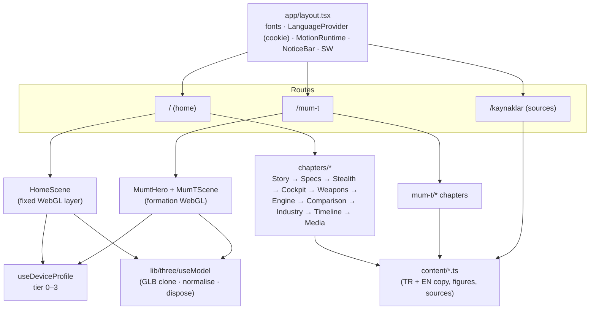

# Architecture

A Next.js 16 App Router site with three pages. Most of it is static content. There are two WebGL scenes and a few canvas and SVG pieces you can interact with.

## Pages

| Route | File | Notes |
| ----- | ---- | ----- |
| `/` | `src/app/page.tsx` | A server component. Its chapters are client islands, and the heavy cockpit chapter mounts through `LazyMount`. |
| `/mum-t` | `src/app/mum-t/page.tsx` | Manned–unmanned teaming: KAAN with two ANKA-3. It has its own formation scene. |
| `/kaynaklar` | `src/app/kaynaklar/page.tsx` | Every image, video and model credit, plus the data sources. |

Both content pages use the same `Navbar` and `Footer`. On `/mum-t` the nav links point to that page's own chapters.

## Chapters

Each section of the home page is one file in `src/components/chapters/`, built on `Chapter` (`src/components/site/Chapter.tsx`). That component draws the numbered left rail, the title, the lede and the content grid, so every chapter has the same frame and differs only in what is inside it.

| # | Chapter | What's interactive |
| - | ------- | ------------------ |
| — | Story (hero + two beats) | the 3D aircraft follows scroll; view presets and wireframe toggle |
| 03 | Specifications | same-scale size frames vs. four other aircraft |
| 04 | Stealth | plan-view outline with an illustrative return pattern computed from its own edges |
| 05 | Cockpit & avionics | three canvas display pages; clickable avionics block diagram |
| 06 | Weapons | mission profiles → internal/external station diagram |
| 07 | Engine | F110 vs. TF35000 table; turbofan station drawing |
| 08 | Comparison | KAAN, F-35A, Su-57, J-20, KF-21 |
| 09 | Industry | work share, production plans, Indonesia contract |
| 10 | Timeline | past events vs. targets |
| 11 | Media | first-flight video; gallery with credited lightbox |

## Text and languages

All text lives in `src/content/*.ts` as typed `Record<"tr" | "en", …>` objects. Components read it with `useT()` or `useLanguage()` from `src/context/LanguageContext.tsx`.

The language is stored in a `kaan-locale` cookie. The root layout reads that cookie on the server, so the first HTML is already in the right language and `<html lang>` matches. There's no flash of the wrong language, and the choice carries over between pages.

## Design tokens

`src/app/globals.css` defines:

- the colour tokens (one accent: `signal`)
- three type families: Archivo for display with its width axis, IBM Plex Sans for text, IBM Plex Mono for data
- a fluid type scale
- a few component classes: `.btn`, `.seg`, `.panel`, `.link`, `.ticks`

Tailwind utilities are generated from the same tokens (`bg-surface`, `text-muted`, `border-line` …).

## Motion

`src/components/site/MotionRuntime.tsx` is mounted once. It does two things:

- **Smooth scrolling.** It runs Lenis, driven by GSAP's ticker, on desktop pointers only.
- **Reveals.** It watches every `[data-reveal]` element. A plain value fades up; `"mask"` wipes a heading in.

Masked headings have no visible area, so the observer watches their parent instead. Content that is already on screen at load is never hidden. With `prefers-reduced-motion`, none of this runs and everything is static.

## 3D

- `useDeviceProfile()` picks a tier before any canvas mounts (see [performance.md](performance.md)).
- `useModel(path, {size, lite})` returns an independent, centred and scaled copy of a GLB. Materials belong to that instance and are disposed on unmount. The `lite` option swaps PBR materials for Lambert on weak devices.
- The home scene (`HeroScene`) is fixed behind the opening chapters. It renders on demand and switches itself off once `#scene-end` scrolls past.
- The `/mum-t` formation scene renders on demand while its hero is visible, and stops (`frameloop="never"`) otherwise.

## Offline and caching

`public/sw.js`: see [performance.md](performance.md#service-worker).
