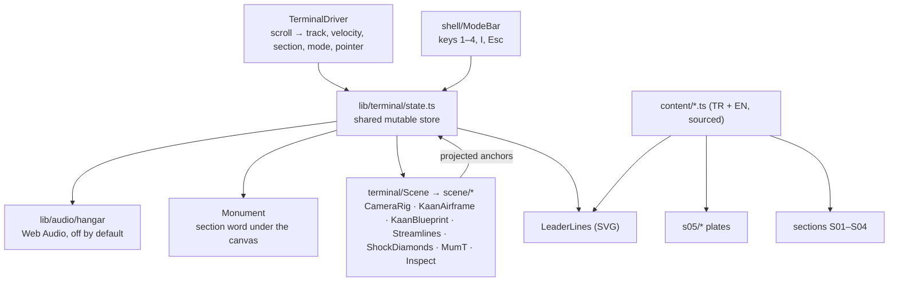

# Architecture

The home page is an engineering monograph built around one pinned WebGL scene. Sections 01–04 scroll over it; section 05 is a run of numbered plates after it.



## Page structure (`src/app/page.tsx`)

```
shell/StatusBar · shell/Frame · shell/ModeBar · TerminalDriver
main
  #track
    sticky 100svh stage: Monument (DOM) → SceneMount (transparent WebGL canvas) → vignette → LeaderLines (lg and up)
    S01 · S02 · S03 · S04   (each 150svh, pulled over the stage with -mt-[100svh])
  s05/S05
shell/Footer
```

`/mum-t` and `/kaynaklar` use the same `shell/StatusBar` and `shell/Footer`. Their 3D scenes are lit by the same procedural hangar (`HangarEnvironment`).

`terminal.track` is the progress through `#track`, from 0 to 1. Each section owns one quarter of it and opens in its own mode (`SECTION_MODE`); the mode bar overrides that until the section changes. `?mode=xray` pins a mode (used by `scripts/capture.mjs`).

## Inspection modes

`rig.ts` exports `modeUniforms`: two one-hot weight vectors (`uFrom`, `uTo` = airframe, x-ray, aero, eo/ir) and a sweep plane `uSweepZ`. Every KAAN material includes `MODE_GLSL` (`shared.ts`) and asks `modeAt(z)` which side of the plane it is on, so one 0.9 s sweep moves the whole aircraft from one mode to the next, nose to tail, with a thin amber cut line. The first sweep starts from nothing once the airframe shader has compiled.

| Mode | What draws |
| ---- | ---------- |
| AIRFRAME | `KaanAirframe`: RAM-grey surface under the hangar light, gold/ITO thin-film canopy, contact-shadow floor |
| X-RAY | `KaanBlueprint`: point cloud, edges, fresnel shell, procedural internals, scan band |
| AERO | the airframe dimmed, `Streamlines` at full length, `ShockDiamonds` |
| EO/IR | the airframe re-shaded as notional long-wave IR (white-hot), plumes in white |

The airframe hides by a screen-space dither rather than transparency, so it keeps writing depth and never needs sorting against the additive point cloud.

## The scene (`src/components/terminal/scene/`)

| File | Role |
| ---- | ---- |
| `CameraRig.tsx` | Two centripetal Catmull–Rom curves (position, look-at). Progress follows a critically damped spring; the look target follows a slower one. It runs the mode sweep, the portrait lens and view offset, and the blend back from free orbit. Mounted first, so the shared values in `rig.ts` are ready for everyone else. |
| `KaanAirframe.tsx` | Desktop class: `MeshPhysicalMaterial` lit by `HangarIBL`. Below that: a matcap with the same hangar pre-integrated. Both get the mode, dither, canopy film and thermal code through `onBeforeCompile`, and compile with `compileAsync`. |
| `HangarIBL.ts` | The hangar as emissive strips and cards, baked once into a PMREM cube when the browser is idle. Also `hangarMatcap()` and `HangarEnvironment` for the MUM-T page. |
| `Floor.tsx` | The opening hero's floor: a light pool and a contact shadow baked once (tier 3), or a soft blob. |
| `KaanBlueprint.tsx` | Merges the GLB meshes (keeping a canopy flag per vertex) and draws the X-RAY layer. |
| `internals.ts` | Procedural line geometry built from the model's bounds: fans, S-ducts, the bay with notional stores, the AESA cone. |
| `Streamlines.tsx` | Vortex trails baked once from a seeded curl-noise field; pulses and length run in the shader. |
| `ShockDiamonds.tsx` | Banded additive cones at the nozzles; cell spacing from λ ≈ 1.22 · D · √(M² − 1) with a representative exit Mach of 1.4. |
| `MumT.tsx` | ANKA-3 point clouds, the KIZILELMA concept node and data-link pulse lines (section 04). |
| `Anchors.tsx` | Projects named 3D points to CSS pixels in `terminal.anchors` every frame. |
| `Inspect.tsx` | Free orbit (`OrbitControls`); the pivot glides from the current look point to the airframe centre. |
| `Stats.tsx` | Renderer counters on `window.__kaanStats`, only with `?stats`. |

The scene runs `frameloop="always"` only while `#track` is on screen and the tab is visible. The canvas is transparent so the monument word can sit under the aircraft. Tier 0 gets a still image and never downloads three.js.

ESLint forbids `new` inside a `useFrame` callback in the scene and MUM-T folders, and `any` everywhere.

## Content

All text and figures live in `src/content/*.ts` as typed `Record<"tr" | "en", …>` objects. `terminal.ts` holds the copy for sections 01–04 and the monument words, `s05.ts` the plate labels of section 05; the others (`aircraft`, `sensors`, `weapons`, `cockpit`, `mumt`, `comparison`, `programme`, `media-credits`, `sources`) are shared with `/mum-t` and `/kaynaklar`.
