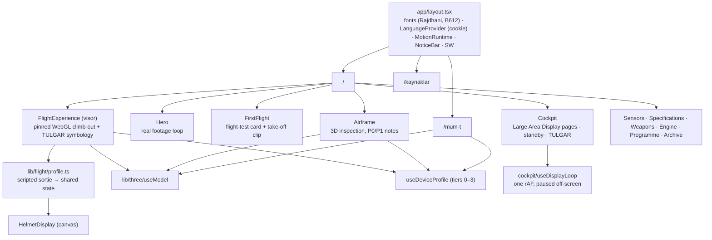

# Architecture

A Next.js 16 App Router site with three pages. The home page tells the aircraft's story in eleven parts. Some of them use real flight footage, two of them are WebGL scenes, and the cockpit is drawn on canvas.

## Home page, in order

| # | Chapter | File | What it is |
| - | ------- | ---- | ---------- |
| — | Hero | `chapters/Hero.tsx` | Real KAAN flight footage in a loop, the name, and the programme status as of November 2026 |
| 01 | First flight | `chapters/FirstFlight.tsx` | 21 Feb 2024: a flight-test card next to the real take-off footage |
| 02 | Visor | `flight/FlightExperience.tsx` | Scroll-scrubbed WebGL climb-out seen through the TULGAR visor. It stays within the first flight's published limits (8,000 ft, 230 kt, gear down) |
| 03 | Airframe | `chapters/Airframe.tsx` | Orbitable 3D model with view presets, a wireframe mode, numbered features and the P0 → P1 changes |
| 04 | Cockpit | `chapters/Cockpit.tsx` + `cockpit/*` | A 2.5:1 Large Area Display (two portals plus a strip of small windows; TSD, RDR, SMS, ENG, FUEL, FCS pages), the standby display and the TULGAR frame |
| 05 | Sensors | `chapters/Sensors.tsx` | The ASELSAN sensor family, with illustrative coverage shapes |
| 06 | Specs | `chapters/Specifications.tsx` | Official TUSAŞ figures and a same-scale size comparison |
| 07 | Weapons | `chapters/Weapons.tsx` | Reported station counts, notional mission loadouts |
| 08 | Engine | `chapters/Engine.tsx` | F110-GE-129 now, TEI TF35000 later |
| 09 | Programme | `chapters/Programme.tsx` | Prototypes, timeline, orders, industrial team |
| 10 | Archive | `chapters/Archive.tsx` | Full flight video and the credited gallery |

## The visor scene

`lib/flight/profile.ts` defines the flight path (a Catmull–Rom curve), plus speed and afterburner curves keyed to scroll progress. It writes one shared `flight` object: position, orientation, pitch, roll, heading, knots, Mach, altitude and g.

- `FlightScene.tsx` reads scroll progress, eases towards it, samples the profile and poses the aircraft. It moves the camera between external shots and the cockpit eye point.
- `HelmetDisplay.tsx` draws the visor symbology from that same object. Pixels per degree come from the camera's field of view, so the pitch ladder lines up with the rendered horizon.
- The world is built from code, with no downloaded assets:
  - Anatolian terrain from deterministic noise
  - a canvas-drawn runway
  - a sky shader also used for reflections
  - instanced cloud sprites from a locally generated texture
  - an additive afterburner plume shader

## Text and languages

All text lives in `src/content/*.ts` as typed `Record<"tr" | "en", …>` objects. The language is stored in a `kaan-locale` cookie that the root layout reads on the server, so the first HTML arrives in the right language.

## Design tokens

`src/app/globals.css` holds the tokens. The colours come from the aircraft's world:

- ink black of a display
- P0 topcoat grey
- TULGAR green for own/normal/selected
- caution yellow
- warning red
- info cyan
- the flag red

The type is Rajdhani for display text and B612 (Airbus's cockpit font) for body and data.
